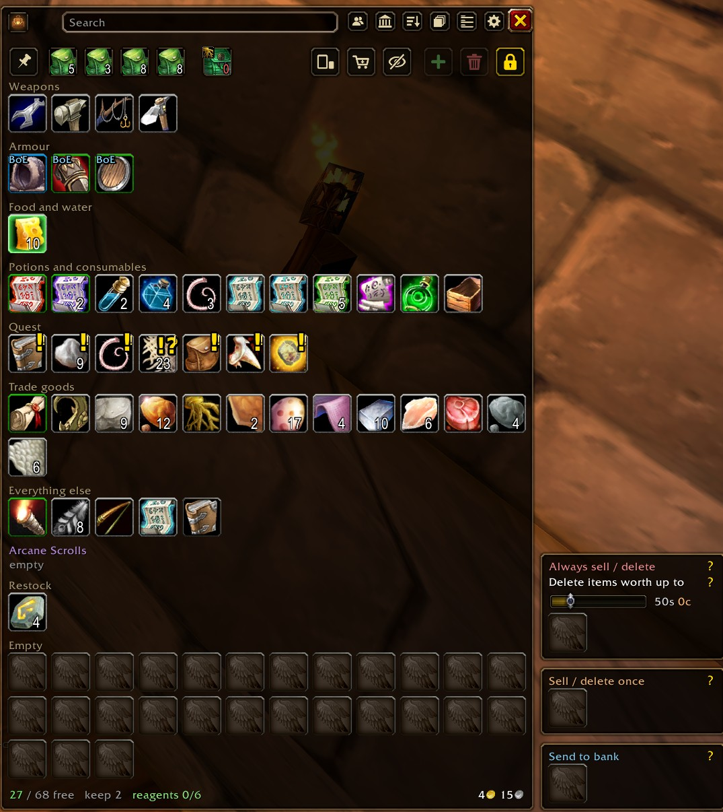

# Rucksack Forever

**A bag addon for World of Warcraft Forever** (interface 16001), with extra features you can turn on or off.

**The bag:** one window with your items in groups you choose, and beside it a window for each job: **Always sell / delete**, **Sell / delete once**, **Send to bank** and your **Quiver**. It keeps a few bag slots free for you, sells your junk at every vendor, sends stacks to the bank by themselves, and sorts herbs, shards, ore and arrows into their special bags. Quest items are marked and kept. It also shows your bank and your other characters.

**Extras (modules you turn on or off in Settings):** **Rations** eats and drinks with one click, **Darkmoon Faire** tracks your tickets, turn-ins and prizes (one click pins where to get an item on your map), and **Scrolls** lets mages decipher their scrolls with one click. A module that's off isn't loaded at all.

Everything is in one window (`/ruck`), with a small on-screen Pocket that shows bag space, your next meal and what a vendor would pay.

**Using another bag addon** (Bagnon, Baganator...)? Turn it off for the full experience: Rucksack's bag replaces it.

## Modules: only load what you use

Rucksack loads only the parts you turn on in **Settings > Modules**. **Bags** is the bag itself, with selling, deleting and the bank built in (it starts on). **Rations**, **Darkmoon Faire** and **Scrolls** are extras. Click the cards you want, then **Apply**. New ones load right away; ones you turned off stop after a reload, and then they use no memory and do nothing. Each character has its own choice, and **Scrolls turns itself on for mages only**.

## Rations: eat and drink with one click

- One button eats your food and drinks your water. It greys out in combat, when you can't eat or drink.
- **Eat button:** pick Food and water (one click does both), Food only, Water only, or Separate (a food button and a water button side by side).
- **Use first:** Strongest first, Conjured first, Save conjured, or Random.
- **Food level:** Any level, Only my level, or Use up old food.
- **Delete below level:** Off, Auto, or a level (5 to 55): old food you've outgrown goes when your bags fill up.
- Warriors and rogues: delete all water as soon as you get it (set per character).
- **Buff food:** tick "Eat buff food when the buff is missing" and it's eaten first whenever you're not Well Fed. A big "don't move" alert counts down while you eat, and tells you when you're Well Fed and can move (you can drag it anywhere).
- **Buff food in one click:** a small "Buff" strip on top of the eat button (green when on, red when off), and a tick on the Pocket's food, switch it on or off. **Remind me when I'm not Well Fed:** a big alert (untick under it to turn buff food off), or off.
- Set any food to "Use this first" or "Never use this".
- Three macros shared by all your characters, kept up to date: **EatDrink**, **Eat** and **Drink**. Drag them onto your bars straight from the Rations page; **Create macros** makes any that are missing.
- Right-click the eat button: the Rations page.

## Selling and deleting: free bag slots, always

**Your bag cleans itself up.** You pick how many free slots you always want to keep, say 4. As soon as you drop below that, it throws out your **cheapest junk first**, the stuff worth the least, until you're back to 4 free slots. No more "Inventory is full" in the middle of a dungeon.

What goes by itself: **grey items**, **white weapons and armour** your class can't wear or that are worse than what you wear in that slot, and **soulbound gear** of any quality your class can't use. Better gear, gear for an empty slot and **profession tools** (Skinning Knife, Mining Pick, fishing poles, enchanting rods...) always stay. Anything else only goes if you told it to: click **Always** when you delete something once. Passing a vendor? It **sells** the junk for gold instead. And it never touches what your quests still need: if a quest wants 8 wolf pelts, it keeps 8.

- **Keep empty slots:** deletes only when you drop below the free slots you want to keep, the cheapest first.
- **Delete items worth up to:** the slider under "Always sell / delete" (10 silver to 5 gold, or no limit). A stack worth more is never thrown away by itself: it waits and is sold at the next vendor. Selling has no limit.
- **The trash button:** shows your free slots against your setting, the first item to go and what it's worth; red when it really deletes on your next key press. Hover it for everything that can go. The **RuckDelete** macro does the same and shows the same item.
- **Deleting by hand:** drag an item out of the bag and Rucksack asks "Delete Linen Cloth x14?", with what it's needed for underneath (a quest, a Darkmoon turn-in, an unread scroll, your next food or water, a profession tool, rare or better). Delete removes it right away; your lists and windows stay as they are. Conjured food and water are deleted without asking.
- Keeps exactly what your current quests still need, never more. Quest starters are kept. Items a quest needs show a yellow **!** in the bag.
- **At a vendor:** sells your Clean-up items and junk for gold instead of deleting them (hold Shift to skip).
- **Open clams and pouches by itself** (on unless you turn it off in Settings): things that open with one click are opened for you, one at a time, and never sold or deleted.
- **At a vendor, it tells you why** something wasn't sold (kept, a quest needs it...) and tries again if the vendor didn't take it.
- Search your list, see what's in your bags, and a history of the last 100 items deleted.

## The bag

B, the bag buttons, vendors, mail and trades open Rucksack's bag. Items work as always: click, drag, split, use. It draws above other windows on your screen.

**The windows beside the bag:** **Always sell / delete** (every one of an item), **Sell / delete once** (just that stack) and **Send to bank** (those stacks go into your bank when you open it). Drop an item on a window to put it there; **Alt + left-click** sends a stack to the bank, **Alt + right-click** takes an item out of any window. A button in the bags row moves them to any corner of the bag.

**Quiver:** while you wear a quiver or ammo pouch, a fourth window shows it slot by slot with how many arrows you have.

**Special bags:** herb, soul, mining, enchanting and other special bags (and the quiver) get their slots tinted in their own colour, and each one is its own group in the bag with how full it is ("Soul bag 12/16"): one tile per item with the total, or slot by slot (your choice for each kind of bag). Anything that fits one moves into it by itself when there's room, before the reagent bag. Pick the colours on the Bags page. With a soul bag, extra soul shards that don't fit in it are deleted (a switch on the Bags page, on to start).

**Restock:** the cart next to Hidden holds the things you always want on you. Pull an item in, type how many to carry, and a vendor that sells it tops you up. It never spends below the gold you choose to keep, and when money is short it buys a bit of everything or fills the top of your list first.

**Bank:** at a banker your bank opens in Rucksack, with its bag slots on top: click the next locked slot to buy it. **Reagents** lying in an ordinary bag move into your reagent bag by themselves.

- **Groups:** Weapons, Armour, Food and water, Potions, Trade goods, Quest, Everything else and your own groups, each on its own row (or Packed side by side). Drag a group by its name to move it; the others slide out of the way.
- **Put an item in a group:** pick it up and every group gets a green **+**. Drop it there and all its stacks go there from now on. Drop it on its own group again to undo.
- **Your own groups:** make one with the green + in the bags row (or drop an item on it); right-click a group's name to rename it, change its colour or delete it.
- **One bag:** no groups, everything sorted by kind, quality or name. Or switch it to **Free**: nothing is sorted, every item stays in the slot you put it in, and Tidy sorts them once when you want.
- **The bags row:** hover Rucksack in the corner and click the arrow. A pin that keeps the bag window where it is, your four bags and the reagent bag with their free slots (drop a bag on a bag to swap), Hidden, New group, Delete group and a padlock that locks the layout.
- **Hidden:** a small bag for things you never need to look at (Skinning Knife, Mining Pick, Hearthstone...). Pull them in and the bag stops showing them; they stay usable from there.
- **Your bank and other characters:** the characters button lists them; point at one and pick **Inventory** or **Bank**. Each opens in its own window, as it was when last seen; at a banker your bank is live. Item tooltips say where else you have an item.
- **Quest marks:** a yellow **!** on quest items, and **!?** on ordinary items one of your quests needs (they're kept for it).
- New items, every empty slot, BoE and "open" tags, Tidy, merged or separate stacks, search, columns and size.

## Darkmoon Faire: tickets, turn-ins and prizes

- Every ticket turn-in: what it wants, how many you have (bank too) and the tickets it gives. Ready, need more, too low level, or closed by your Faire reputation.
- **Where to get it:** good farm spots for each animal part, closest to your level first. Click one to pin it on your world map (TomTom too); shift-click pins them all. Crafted items show their profession and materials.
- **Plan:** pick your prize, tick the turn-ins you want and how many times; it counts the tickets, the items and raw materials still needed and the hand-ins your reputation allows. The prize card on screen shows it as a table.
- **Prizes:** click a prize to track it. The Pocket and Home show it as 37 / 50; turn on the on-screen ticket button for a card that fills up and glows gold when you have enough.
- Darkmoon deck checklist, the Faire's dates and places, Sayge's answers.
- Item tooltips, and quick turn-ins at Yebb, Kerri, Rinling and Chronos (hold Shift to do it yourself). Clean-up keeps the turn-in items.

## Scrolls: one-click decipher (mages)

- One click on the scroll button (or the **Decipher** macro) casts Comprehend Scroll on your next scroll: the hardest one your Comprehension skill allows, so you never get turned into a sheep.
- A page with your Comprehension skill and every scroll in your bags. Clean-up keeps undeciphered scrolls; other classes keep them to send to their mage.

## Home, Pocket and Guide

- **Home:** bag space, your next food and water, what's waiting to go, and what a vendor would pay right now.
- **Pocket:** a small window that stays on screen with the same numbers and your Darkmoon prize. Four styles: **Rows**, **Tiles**, **Strip** (just icons and numbers, across or down) and **Ledger** (text only). Right-click it for its settings.
- **Guide:** every feature explained in the game. Hover any option for a short tip.
- **New version notice:** when an important update is out and someone in your guild or group has it, you get a line at login saying so (can be turned off in Settings).

## Commands

- `/ruck` or `/rucksack`: open the window. Everything else is in there.

## Install

Get it from [CurseForge](https://www.curseforge.com/wow/addons/rucksack-forever) (pick your WoW Forever install in the CurseForge app), or download the zip from [Releases](https://github.com/Mustac/RucksackForever/releases) and unpack it into `World of Warcraft\_forever_\Interface\AddOns`. The zip holds six folders: `Rucksack` and its modules `Rucksack_Rations`, `Rucksack_CleanUp`, `Rucksack_Bags`, `Rucksack_Faire` and `Rucksack_Scrolls`. Keep them all; pick what loads in Settings > Modules.

Rucksack is a bag addon: turn off other bag addons like Bagnon and Baganator.

## Website and feedback

[rucksackforever.duckdns.org](https://rucksackforever.duckdns.org/) has what Rucksack does, what's new, and a [form for bugs and ideas](https://rucksackforever.duckdns.org/report) anyone can use, no account needed. Add a screenshot if it helps. You get a private link where you see the answer and when it's fixed, and the [Fixed and added](https://rucksackforever.duckdns.org/fixed) page shows what came from players' reports. In the game, **Report a bug** at the top of the Rucksack window gives you a ready-made report to paste there. Only the developer reads the reports.

## Support

Enjoying Rucksack Forever? You can [buy me a coffee](https://buymeacoffee.com/zyxon) ☕

## Releasing

Releases are automatic. To release a new version:

1. Raise `## Version` in `Rucksack.toc` (for example to `1.3.1`).
2. Add the changes at the top of `CHANGELOG.md`.
3. Push to `main`.

The GitHub Action sees the new version, tags it (`v1.3.1`), builds the zip and uploads it to CurseForge and GitHub Releases. Pushes that keep the same version release nothing.

The CurseForge API token is stored as the repository secret `CF_API_KEY`.
